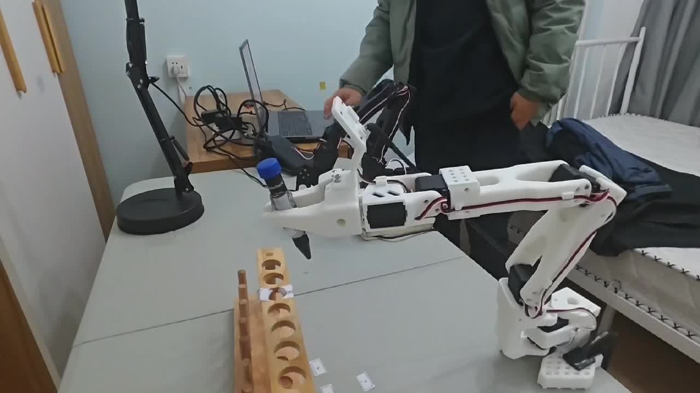
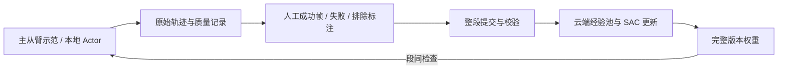

# SO101 HIL-SERL：人工奖励与真机接管训练

基于 [Berkeley HIL-SERL](https://github.com/rail-berkeley/hil-serl) 的 SO101 真机适配。任务为夹持试管后的对位与插入：先主从臂采集示范，再进行本地策略执行、人工接管、段后成功帧标注和云端训练。

[](docs/media/so101-real-robot.mp4)

[播放 / 下载约 20 秒真机视频](docs/media/so101-real-robot.mp4)。视频展示实际装置与运动过程；当前未配套逐帧控制来源标签，不能将整段认定为纯策略执行或用单条视频推算成功率。[视频来源](docs/so101/video.md)

**阅读入口：** [贡献与证据](docs/so101/evidence-map.md) · [安装与操作](docs/so101/quickstart.md) · [离线验证](docs/so101/validation.md) · [上游介绍](README_upstream.md)

## 实现要点

- **统一动作执行：** 模型和人工共用相对关节目标增量入口。pan / lift / elbow 三维可动，腕部与夹爪在录制期间冻结；10 Hz、5.5°/关节/步。观测包含目标误差和补偿，保持动作基准可见。
- **连续接管：** 第一次空格暂停模型，第二次空格刷新主从臂差分基准并开始人工控制，减少切换跳变；思考暂停不生成训练步。控制窗口保存接管次数上限，D 结束当前段但不自动判成功。
- **人工奖励：** 本地保存原始轨迹，人工选择成功观测帧后，奖励赋给其前一动作并停止自举；失败/超时截断与成功终止分别处理。标注后整段上传，未标注或排除的数据不进入训练。
- **训练闭环：** 本地 Actor 推理，云端 Learner；在线数据池与示范/接管池混合采样；完整 checkpoint、收录回执和预算支持恢复，权重在段间检查并切换。
- **采集工程：** 异步写盘、质量标记、键盘事件时延、归位反馈校正；扩展入口可只录动作并进行主从臂回放，回放数据单独标记。



## 当前配置与代码导航

| 内容 | 默认 / 实现 |
|---|---|
| 图像 | 同一 cam_main 的两路 ROI：cam_main、cam_main_roi，224×224 |
| 状态 / 动作 | 18 维状态 / 3 维相对关节目标请求 |
| Batch / gamma / CTA | 256 / 0.99 / 2，见 [config.py](examples/experiments/so101/config.py) |
| 模型和人工执行 | [env.py](examples/experiments/so101/env.py)、[joint_control.py](examples/experiments/so101/joint_control.py) |
| 原生串口与对齐 | [native_env.py](examples/experiments/so101/native_env.py)、[native_io.py](examples/experiments/so101/native_io.py) |
| 录制与 GUI | [record_demo_so101.py](so101_tools/record_demo_so101.py)、[control_panel.py](so101_tools/control_panel.py) |
| 标注与奖励 | [label_demos.py](so101_tools/label_demos.py)、[human_reward.py](examples/experiments/so101/human_reward.py) |
| Actor / Learner | [train_human.py](so101_tools/train_human.py)、[online_training.py](so101_tools/online_training.py) |

更新调度既支持持续异步更新，也支持新增数据预算；命令中显式选择，不把历史运行参数当成当前默认。相机使用配套 [so101-ros2](https://github.com/nkzwchen/so101-ros2)，机械臂使用 LeRobot 原生 IO。

## 无硬件验证

在安装项目依赖的 Python 环境中执行，测试不连接相机、串口或云端：

```bash
PYTEST_DISABLE_PLUGIN_AUTOLOAD=1 python -m pytest -q   so101_tools/test_joint_control.py so101_tools/test_human_reward.py   so101_tools/test_online_training.py so101_tools/test_async_recorder.py   so101_tools/test_training_keys.py so101_tools/test_fullframe_replay.py
```

录制、标注、云端训练与 Actor 命令见 [quickstart](docs/so101/quickstart.md)。当前机型的标定、设备路径与 ROI 必须在另一台设备上重新配置；离线测试通过不代表可直接驱动任意 SO101。

## 验证范围

仓库提供实现、软件测试和真机演示。暂缺独立试验表，因而不把“成功率 50%→60%”或“收敛时间缩短 30%”列为已核实结果。当前奖励实现也未加入接管前 3 步惩罚。后续实验应固定任务成功定义、接管规则、数据和 checkpoint 后补充。

标准录制结束后需要人工退出接触并回程，下一段 reset 做精确归位；动作回放扩展在确认退出接触后自动恢复到本段起点。两种流程不能混称为录完即自动拔出试管。

历史排查和旧命令保留在 [历史说明](docs/so101/history-202610.md)，不作为当前启动入口。上游算法与网络来自 HIL-SERL，本分支工作是 SO101 控制、数据契约、人工奖励和部署流程适配；遵循 [原许可证](LICENSE)。
